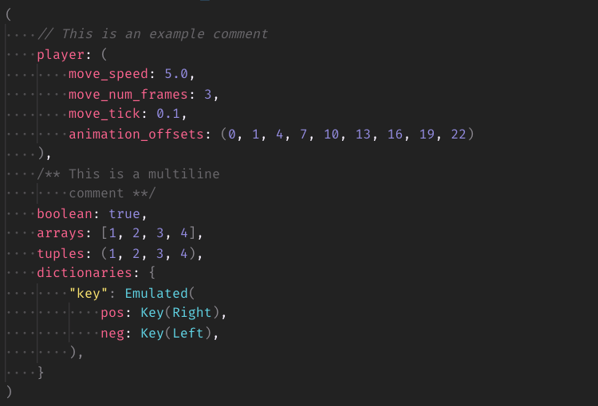

# vscode-ron

vscode-ron adds RON syntax highlighting and formatting to VS Code. Highlighting is loosely based on
https://github.com/ron-rs/sublime-ron


## Where can I get this?

- [Visual Studio Code Marketplace](https://marketplace.visualstudio.com/items?itemName=a5huynh.vscode-ron)
- [OpenVSX Marketplace](https://open-vsx.org/extension/a5huynh/vscode-ron)


## What is RON?

[Rusty Object Notation](https://github.com/ron-rs/ron) (RON) is a simple
readable data serialization format that looks similar to Rust syntax,
designed to support all of Serde's data model. Check out the RON repository
for more information!


## Formatting

Format Document (`Shift+Alt+F`, or `Shift+Option+F` on macOS) runs an external
formatter, [fmtron](https://crates.io/crates/fmtron) by default:

```bash
cargo install fmtron
```

The document is piped to `fmtron --stdin-filepath <file>`, so formatting
matches running `fmtron` on the command line: comments are preserved and the
nearest `fmt.ron` (or `.fmt.ron`) above the file is respected. If the
formatter fails (e.g. a parse error), the document is left unchanged and the
error is written to the "RON Formatter" output panel.

To format on save:

```json
"[ron]": {
    "editor.formatOnSave": true
}
```

### Settings

| Setting | Default | Description |
|---|---|---|
| `ron.formatter.path` | `"fmtron"` | Formatter executable (user/machine settings only). Any formatter that reads stdin and writes stdout works. |
| `ron.formatter.maxWidth` | unset | Passed as `-w`. Unset → `fmt.ron` or formatter default. |
| `ron.formatter.tabSize` | unset | Passed as `-t`. Unset → `fmt.ron` or formatter default. |
| `ron.formatter.extraArgs` | `[]` | Extra arguments, e.g. `["--blank-lines", "remove"]`. |

Prefer a `fmt.ron` in your project over `maxWidth`/`tabSize`: command-line
flags override it, and it keeps editor and CI formatting in sync.


## Highlighting Example

Here's a lovely example of what a basic `.ron` file will now look like:




# Development

Check out VS Code's excellent guide on syntax highlighting extensions [here][extension-guide].
That will help you get setup with the right tooling to start making/testing changes to the grammar.

[extension-guide]: https://code.visualstudio.com/api/language-extensions/syntax-highlight-guide

## Building & testing

```bash
npm ci
npm test    # compiles TypeScript, runs grammar and unit tests
```

## Debugging extension

While in VSCode, press `F5` (or `Run` -> `Start Debugging`) to launch a
version of VSCode with the extension loaded.

Load `./docs/example.ron` if you need an example RON file to work on.